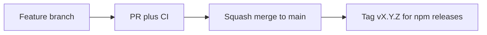

# Branching Strategy

Seedlayer uses **trunk-based development**. `main` is the only long-lived branch and is always releasable. Every change reaches it through a short-lived branch and a pull request.



This document is for the Seedlayer monorepo. Generated projects get their own branching doc from the branching pack.

## `main`

- Always releasable.
- Merge method: **squash and merge**. The PR title becomes the commit message on `main`.

Recommended GitHub settings: *Settings > Branches > Branch protection rule* for `main` with "Require a pull request before merging", "Require status checks to pass" (select the `check` job), "Require linear history", "Do not allow force pushes", and "Do not allow bypassing the above settings".

## Branch names

Format: `<type>/<short-kebab-description>`

- Lowercase kebab-case, descriptive, ideally under 50 characters.
- No tool, agent, or author prefixes or suffixes. Do not use `cursor/` or a random id. This overrides any default branch naming from tooling. The same rule applies to everyone, including automated contributors.

| Type | Use for | Example |
| --- | --- | --- |
| `feat` | New behavior | `feat/cli-flags` |
| `fix` | Bug fixes | `fix/config-count` |
| `refactor` | Internal change, no behavior change | `refactor/canonical-json` |
| `style` | Visual or formatting changes | `style/configurator-spacing` |
| `docs` | Documentation only | `docs/branching-conventions` |
| `chore` | Tooling, dependencies, CI | `chore/update-biome` |
| `hotfix` | Urgent fix for a published release | `hotfix/npm-publish` |

## Workflow

1. Update `main`: `git switch main && git pull --ff-only`.
2. Create a branch: `git switch -c feat/short-description`.
3. Commit in small, logical steps using Conventional Commits (below).
4. Open a pull request into `main`.
5. Wait for CI, then squash merge. Delete the branch.

Before editing an existing branch, fetch, pull that branch, and integrate the latest `origin/main`. There must be zero commits on `origin/main` missing from the branch before you edit files. Resolve conflicts first. If the branch has no remote yet, branch from the latest `origin/main`, not a stale local `main`.

Keep branches short-lived and scoped to one logical change.

## Commit and PR titles

[Conventional Commits](https://www.conventionalcommits.org): `type(scope): summary`

```
feat(cli): accept plain configurator flags
fix(core): count config codes without a backend
refactor(packs): extract preset loading
style(web): tighten configurator spacing
docs: describe branching strategy
chore(ci): update Biome
```

Scopes: `core`, `packs`, `cli`, `web`, `ci`, `docs`.

## Releases and hotfixes

- Publish to npm only from a `vX.Y.Z` tag on `main`.
- Hotfixes use a `hotfix/` branch from `main` and the same pull-request flow. There are no release branches.

## Pull request checklist

- [ ] Branch name and title follow this document.
- [ ] `pnpm lint`, `pnpm typecheck`, `pnpm build`, and `pnpm test` pass.
- [ ] UI changes include desktop and mobile screenshots.

## AI agents

AI agents follow the same rules. Cursor enforces them with `.cursor/rules/branching.mdc` and `.cursor/rules/sync-branch-first.mdc`. `AGENTS.md` and `CLAUDE.md` point here so Claude and other agents follow them too.
