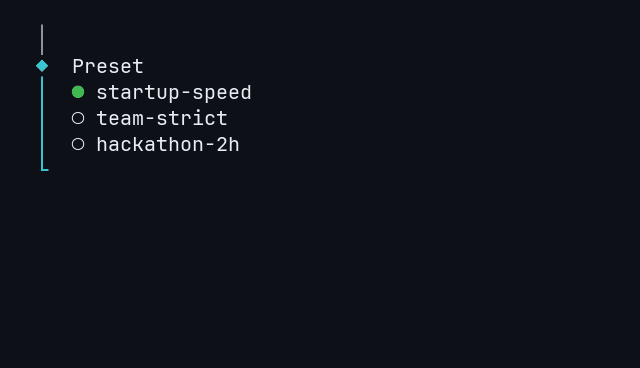

# seedlayer

Generate a Next.js app and the AI context layer from one config.

[](https://www.npmjs.com/package/seedlayer)
[](https://github.com/kdjadeja21/seedlayer/blob/main/LICENSE)
[](https://github.com/kdjadeja21/seedlayer/actions/workflows/ci.yml)
[](https://nodejs.org/en/)



## Quick start

```bash
npx seedlayer@latest my-app
```

```bash
pnpm dlx seedlayer@latest my-app
```

```bash
yarn dlx seedlayer@latest my-app
```

```bash
bunx seedlayer@latest my-app
```

On a terminal, arrow keys move, Enter selects, and Space toggles agents.

## What you get

A Next.js app (TypeScript, Tailwind, shadcn, and Vitest), plus:

- `AGENTS.md`, the short index other tools read
- `CLAUDE.md` and `.claude` when Claude Code is selected
- `.cursor` when Cursor is selected
- `BRANCHING.md`, the git rules every agent shares
- an optional Seedlayer credit on the home page (`--no-credit` leaves it out)

## Presets

Each preset builds that Next.js app, with conventional commits and the home-page credit on.

| Preset          | Defaults                                                                                                                                           |
| --------------- | -------------------------------------------------------------------------------------------------------------------------------------------------- |
| `startup-speed` | agent-safe branches, Biome, ink / Inter / md, Cursor and Claude Code, plan, implement, review, Husky, commitlint, CI, and PR review                |
| `team-strict`   | GitHub Flow, ESLint, harbor / Geist / sm, PascalCase components, Result errors, 200-line files, Cursor and Claude Code, and the same quality gates |
| `hackathon-2h`  | trunk, Biome, grove / Geist / lg, Cursor only, implement, and CI only                                                                              |

## Options

Pass a flag to override the preset. A value you leave out stays on the preset. Boolean flags are off unless you pass them.

| Flag                      | Values                                                                              | Default         |
| ------------------------- | ----------------------------------------------------------------------------------- | --------------- |
| `--config <code-or-file>` | an `sl1` code or a JSON config file                                                 | none            |
| `--preset <name>`         | `startup-speed`, `team-strict`, `hackathon-2h`                                      | `startup-speed` |
| `--palette <name>`        | `ink`, `harbor`, `ember`, `iris`, `grove`, `dusk`                                   | preset          |
| `--font <name>`           | `Inter`, `Geist`, `system`                                                          | preset          |
| `--radius <name>`         | `none`, `sm`, `md`, `lg`                                                            | preset          |
| `--agents <list>`         | comma-separated `cursor`, `claude-code`. `claude` is a short name for `claude-code` | preset          |
| `--lint <name>`           | `biome`, `eslint`                                                                   | preset          |
| `--branching <name>`      | `trunk`, `github-flow`, `agent-safe`                                                | preset          |
| `--no-credit`             | Omit the Seedlayer credit on the home page                                          | off             |
| `--use-npm`               | Install and run scripts with npm                                                    | off             |
| `--use-pnpm`              | Install and run scripts with pnpm                                                   | off             |
| `--use-yarn`              | Install and run scripts with yarn                                                   | off             |
| `--use-bun`               | Install and run scripts with bun                                                    | off             |
| `--disable-git`           | Skip git init and the first commit                                                  | off             |
| `--yes`                   | Skip questions and use the preset defaults plus flags                               | off             |
| `--interactive`           | Ask the questions even when flags are passed                                        | off             |
| `--no-interactive`        | Skip the questions                                                                  | off             |
| `-i`, `--immediate`       | Install, then start the dev server                                                  | off             |
| `--reset-preferences`     | Forget the saved answers                                                            | off             |
| `--skip-install`          | Write files only                                                                    | off             |
| `--skip-verify`           | Install dependencies and skip lint and typecheck                                    | off             |
| `--force`                 | Replace a non-empty directory                                                       | off             |
| `--version`, `-v`         | Print the CLI version                                                               |                 |
| `--help`                  | Show this help                                                                      |                 |

With none of the `--use-*` flags, install uses the package manager that launched the CLI, or npm. Git still initializes and commits `Initial commit from seedlayer` unless you pass `--disable-git`. The last interactive answers are saved in `~/.seedlayer.json`.

`--config` cannot be combined with `--preset`, `--palette`, `--font`, `--radius`, `--agents`, `--lint`, `--branching`, `--no-credit`, `--use-npm`, `--use-pnpm`, `--use-yarn`, `--use-bun`, `--disable-git`, or `--immediate`.

## Non-interactive / CI

`--yes` skips the questions and the confirmation. `--no-interactive` skips the questions. A shell that is not a terminal does the same when you pass no config flags. `--config` applies a full config.

```bash
npx seedlayer my-app --yes
```

```bash
npx seedlayer my-app --no-interactive --preset team-strict
```

```bash
npx seedlayer my-app --config ./seedlayer.json
```

## Config codes (sl1)

An `sl1` code is the whole config in one token. This one is the `startup-speed` preset:

```bash
npx seedlayer my-app --config sl1.eJxdkk2L3DAMhu_zK4zPM7ClPc0P6Ad0obDQy9KDxlYSNbacysrMDsv-92I7H9tegqPXsqRH7-vBGAs9smZ7Ns_WzZKT2KOxLsDs8eSSR_vrWK6V45PeA9qzeT0YY4xFkSRfgX0g7u3ZWB0k3eyxqV0KHqU8bDsEnQVXJRArShEulOIWjvDymQJ-J8aS9fHhYREY4lJgxAtcTh0FzGtWViGnjLlWan_2YMxb61rQk9qzUZmxRjxm6nkfwiNn0ntJdil2SRQuAfchWJ-A69vfateLMEFA1QLDEo9rVMDTXC9HvzfR1w6Wei7FSJW3dYmvyEqJIbyD8ENWBJ82BLckYxfSraTVhZ0ydLiXoBjRE9SGOgi5zUpM-uXf8SdwI_T4CAx92wFP0TZJMKM2iiA6T6c8Ifom_pkhNEzPdpjzeK8uqbOUddY_Kt9JToJXwtvim-wGjPATJVMq2D-0qIIbdygw61B7SbyhdylOiRdv2jyAd7xqHhQukPH_nE4gYmFVBXzR35tPhpR1cdEVxeFGPAD3M_T1Lb1PmJ3QpLu97pu7gcKN2K-SYm69Xakc92W8W9aznQJw4UJxChixoVoJHd4OfwEBxgUj
```

Build another code in the [web configurator](https://github.com/kdjadeja21/seedlayer/tree/main/apps/web). From a checkout, run `pnpm dev` and open http://localhost:3000.

## Requirements

Node.js 20 or newer.

## Contributing

See [CONTRIBUTING.md](https://github.com/kdjadeja21/seedlayer/blob/main/CONTRIBUTING.md).

## License

MIT. See [LICENSE](./LICENSE).
